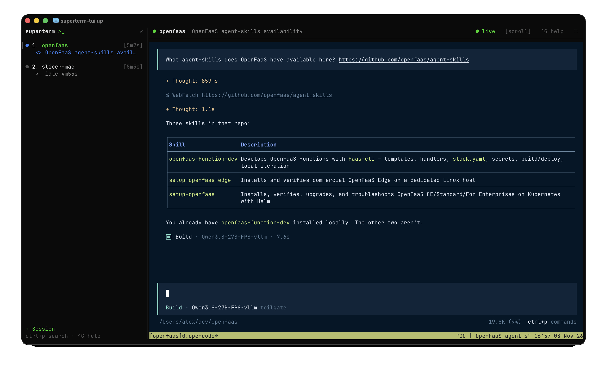

In this post I’ll explain what Agent Skills we’ve created for OpenFaaS users to move faster with serverless functions. From setup, to development, to tracking down troublesome issues.

## How we got to coding agents and how we can never go back

Many of us may have trouble remembering what it was like to write code until our fingers were sore and wrists ached. This period of time is now known as “manual coding” and considered by many to have been made obsolete by coding agents like Claude and Codex. Things started changing with the introduction of ChatGPT and the Co-pilot plugin for VSCode, and that’s also when Cursor became popular.

I’d paste in hard problems, or functions that were baffling me into ChatGPT, and get back a reasonable alternative to try, even if it took a number of turns and was repetitive. With VSCode, I’d type code then wait as I saw the auto-complete suggestion pop up - that struct that had 5 fields, only needed me to write one, and hit tab to get the others. Cursor felt innovative because when I was making an edit like moving a private function to a struct, I could hit tab and it’d get me to the next similar function and suggest the same change.

I can’t remember exactly when it was, but a ChatGPT-like experience moved into a dockable window in both VSCode and Cursor, and typing messages into that message would result in the IDE making all of the changes I mentioned above. I used an early Sonnet model to convert my Ghost 1.0 blog that was well out of maintenance to convert the entire thing into a visually matching static website with React. It took a couple of days and the migration went smoothly.

At some point after that, the chat moved into a CLI - opencode, claude, codex, and amp. That was the point at which I believe many of us stopped reading the code, and relied on a higher level human or automated review. Some vendors are making bold predictions and recommendations to avoid reviewing code, with the reasoning that agents can catch and fix issues on their own. We took a more nuanced approach and implemented [a fully automated code review](https://slicervm.com/blog/evolving-our-code-review-bot-with-slicer-sandboxes/) where we need a 8/10 or higher to merge, plus some consideration of the broader impact to an ecosystem - that's something that a single coding agent can't hold in mind today.

Some of us would go back gladly, but only if it was a level playing field. You see, writing CRUD apps by hand, vs with a coding agent is so transformative that to be competitive there isn’t really another way.

## If we can’t go back, how do we go forward?

I remember a new OpenFaaS customer that was a heavy user of claude. He showed me a Python function with the completely wrong handler, and somehow it worked - some of the time. I remember him misunderstanding how autoscaling worked, and instead of relying on the throughput, concurrency, or CPU, he tried to force everything through a single replica using threads. I would not have touched that function with a barge pole.

And the experience did not stop there - when I tried to create functions using the latest Opus model, it’d get them wrong and thrash, then need pointing at the docs. The same was the case for setup, and installation. Where they did excel was in diagnostics across the cluster, especially if given some docs. When the models were editing existing functions, they had much fewer issues, and that’s when we started to look at Agent Skills.

## Skills

> OpenCode running inside our Superterm agent manager, exploring the available skills.

**The first skill - setup-openfaas**

The first skill was a setup-openfaas skill which covered the OpenFaaS Standard installation. We built it for ourselves for supporting customers by reproducing an installation quickly, and for end-to-end testing of new features. The initial version was too chatty, and ended up taking almost 23 minutes - but with some refinement, and stronger direction, we could set up a fully configured Kubernetes cluster, deploy a function, and invoke it in a SlicerVM within around 2 minutes 30.

The skill now covers OpenFaaS CE for those who want to try out the product for free, or for personal use at home, without having to read docs. OpenFaaS for Enterprises has some additions like the Function Builder API, Kafka Connector, and IAM/SSO - all of which can be driven by almost any model including an open weights model like Qwen 3.8 27B.

We liked the setup-openfaas skill so much that we made one for [OpenFaaS Edge](https://openfaas.com/edge) customers too - that's OpenFaaS that runs entirely on a single VM or bare-metal device, with no Kubernetes or clustering for redistribution at a lower cost point.

**The second skill - openfaas-function-dev**

I asked my colleague to collate the documentation for the officially supported languages like Python, Node, Go, Java, and such and to have them formalised into a skill. He went through a number of iterations until we could ask the agent to write specific examples like “Write a Python function to connect to Postgresql, parse the body and insert it into a table. You also need to create the table if it doesn’t exist”.

So, today, if you want to write or edit a function, you can just say “Use the openfaas-function-dev skill to extend this function to do X” or “Use the openfaas-function-dev skill to create a new Java portal which is protected by OAuth directly in the function".

**The third skill - diag**

The third skill is not quite a skill - but it’s very closely related, and we may well make one to sit around it. It’s a CLI called `diag` which takes a detailed snapshot of an OpenFaaS installation including Pods, CRDs, Function definitions, IAM objects, and logs of every major component. Once the snapshot is complete, an `AGENTS.md` file is written out that you can point your agent at.

Whenever we are sent a `diag` dump, the first thing we do is to launch a network restricted SlicerVM, and to copy the zip file into it. We then allow one egress rule to our private LLM gateway which serves self-hosted models on hardware we solely own and operate on company premises. From there, we tell the agent to explore and find potential causes.

We’d had a customer complaining of a network reliability issue and had exchanged dozens of emails in a thread over a couple of weeks. Each time, we’d send 4-5 commands to run, and be lucky to get 1 or 2 of them run, sometimes with incomplete output. This new approach was truly transformative and we pointed them at AWS networking. They found a couple of nodes that were unreliable and that needed to be deleted, there were no more issues after that point.

## Getting started

Whether you’re early or really got stuck in already with your AI journey, the skills are an essential that we would not go without. You can run the instructions in the repository, or simply ask your agent the following:

> Please install agent-skills for openfaas, from: https://github.com/openfaas/agent-skills

Then either refer to them by name, or quite often the agent will discover them itself and just use them.

We tend to recommend using coding agents within a secure sandbox such as our own SlicerVM product. SlicerVM runs on macOS, Linux, and WSL2 and can isolate both the network, and compute. You may be wondering how to get changes into or out of a VM. You can choose between worktrees, or the credential broker where the agent makes requests and has them authenticated by the host. Of course your own automation with bash, an agent, or our Go/TS SDK are just as valid - whatever fits.

If you’d like a demo of how the skills work, what they can do, and what our AI stack looks like, we’d be more than happy. Just email us through your usual contact and we’ll get something on your calendar.

* [Officially supported languages](https://docs.openfaas.com/languages/overview/)
* [Agent skills](https://github.com/openfaas/agent-skills)
* [Free trial of SlicerVM](https://slicervm.com)
